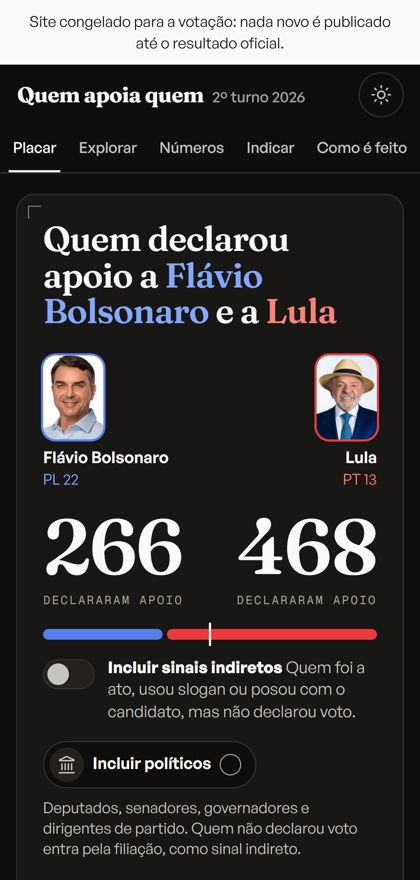
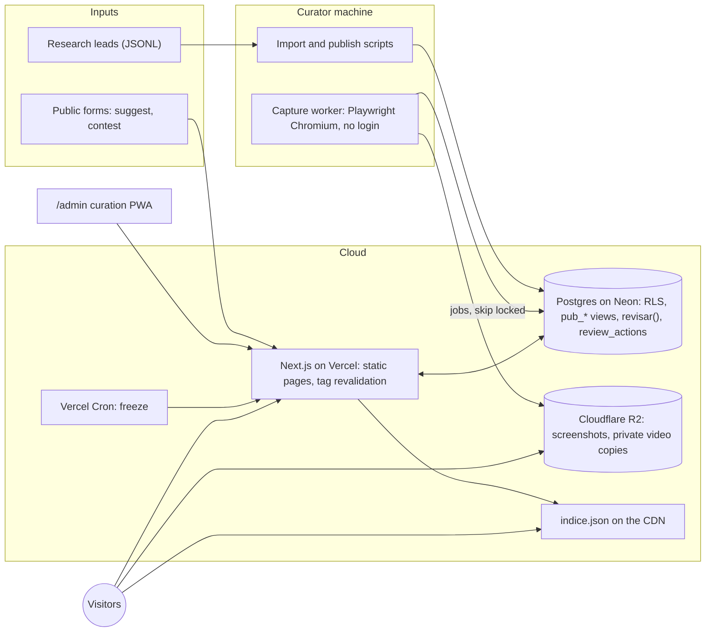

<h1 align="center">Quem apoia quem</h1>

  <strong>A public, neutral record of which public figures declared support for which candidate in Brazil's 2026 presidential runoff, with proof for every entry.</strong>

  For voters, journalists and teachers who want to check what someone actually said, not what others claim they said.

  <a href="https://quemapoiaquem.com.br"><strong>Live product →</strong></a>

<table>
  <tr>
    <td width="76%"></td>
    <td width="24%"></td>
  </tr>
</table>

---

## What it is

A public website in Portuguese that lists what public figures with 100,000+ followers said about the 2026 presidential runoff (Flávio Bolsonaro, PL, and Lula, PT, voting day 2026-10-25). Each person has a page with their statements, and each statement links to the original post, a screenshot taken at capture time and the exact quote.

It was built from zero starting 2026-10-05, was in production on its own domain on 2026-10-06, froze automatically on 2026-10-24 at 23:59 (Brasília time) and is now a permanent archive.

## The problem

During a runoff, "X supports Y" circulates as screenshots of screenshots. Some are real, some are old, some come from fan pages, some are jokes. There was no single place where a claim could be checked against the person's own post, dated, and classified with the same rule for both sides.

The hard part is not the website. It is deciding, at volume and under time pressure, what counts as support, and doing it the same way for both candidates.

## How it works

1. **Discovery.** Research agents and the public (a "suggest someone" form on every profile) produce leads: a post URL and a name.
2. **Capture.** A worker opens the post's public embed page in a headless Chromium with no login and stores a screenshot, the caption, the posting account and its follower count. On X and Instagram the publish time is decoded from the post ID itself.
3. **Classification.** Each item gets a type (explicit support, indirect signal, neutrality, null or blank vote, criticism), a candidate and the decisive quote. A second reading re-checks it against all other items from the same person.
4. **Gate.** Only clear explicit support from the person's own account passes straight to publication. Ambiguity goes to the curator queue. Missing data (no account found, no date, under the follower cutoff) goes to a separate technical backlog, not to the curator.
5. **Curation.** The curator approves, corrects, rejects, skips or undoes from a keyboard-driven admin (installable as a PWA). Every action is logged with who did it.
6. **Publication.** Approval revalidates only the pages that changed. The profile shows the quote, the screenshot, the date, the platform and a link to the original.
7. **Corrections and freeze.** Anyone can file a correction, right of reply or removal request; resolved corrections are listed publicly. A scheduled job froze the site before the vote.

## Proof and neutrality model

Every published statement carries its proof, and the database enforces it:

- A published explicit support **must** have a literal quote that is a substring of the captured text. This is a `CHECK` constraint on the `statements` table, not a UI rule. Without the literal quote, the item is downgraded to indirect signal.
- Every statement keeps the original URL (unique canonical URL), a screenshot and the capture date. Videos play through the platform's own player, loaded on click; a private copy is kept only as backup proof.
- A removal request hides the person from the site without deleting the proof.

Neutrality is written as engineering constraints in the repo contract, so a change that breaks one is a bug:

- Candidates always appear side by side, same size, in a fixed order taken from `candidates.ordem` (alphabetical by ballot name). One function decides candidate color; both colors have the same OKLCH lightness, and a test checks they stay distinguishable under protanopia, deuteranopia and tritanopia.
- No list sorts by position by default (default is largest network, or alphabetical). Home page highlights are chronological, never hand-picked.
- Criticism of one candidate is never counted as support for the other. The one exception applies the same way to both sides and shows the person's exact sentence.
- The scoreboard counts only explicit support. Indirect signals and politicians are opt-in toggles that start off. Every statistics block carries a "this is not an electoral poll" notice.
- Politicians enter by party affiliation only for the two candidates' parties and the officially registered coalition, as indirect signal, using Chamber, Senate and electoral court (TSE) open data. Parties with no official side get no automatic label: only people who spoke are listed.
- Foreign public figures follow the same rule as Brazilians; foreign politicians and governments are excluded on both sides.

## Architecture

- **Public side** reads only `pub_*` views. Base tables have no policy for the anonymous role, so a new column cannot leak by accident; exposing one means editing a view.
- **Business rules** live in `src/server/domain` and in SQL migrations (24 of them). The review rule is a SQL function, `revisar()`, that changes status and writes `review_actions` in the same transaction.
- **The worker** pulls jobs from a queue table with `for update skip locked`, so two workers never take the same job. Browser, storage and AI are injected adapters, so the same jobs run in tests with fakes.
- **Explore page** downloads one JSON index from the CDN and filters in the browser. A traffic spike does not reach the database.

## Engineering decisions

**1. Raw SQL with a role per transaction, instead of the Supabase client.** The server talks to Postgres through `pg` and sets `set local role anon | authenticated | service_role` plus the user claim in each transaction, so row-level security behaves the same in production and in tests, which run against real Postgres (PGlite), with no database mocks. When the planned Supabase project hit the free-tier limit, this made the move to Neon a connection-string change. Cost: auth had to be built in-house (scrypt passwords, session tokens stored only as SHA-256, rate-limited login), and there is still no second factor.

**2. Publication rules in the database, undo as a reversal.** Taxonomy invariants are `CHECK` constraints and the review flow is one SQL function, so the admin, batch scripts and auto-approval all go through the same path and the same audit log. Undo applies immediately and restores the previous snapshot, instead of holding publication for a grace period. Cost: a wrong item can be live for a few seconds; accepted because revalidation is immediate in both directions. The freeze is also enforced in SQL: while frozen, publishing raises an error, unpublishing still works.

**3. Static pages, tag revalidation, no database per visit.** Pages are cached and expire by tag (`placar`, `indice`, `perfis`, `pessoa:<slug>`, `congelado`). An admin action expires only the lists and the profiles it touched. When the public dataset passed the 2 MB cache item limit (2,443,416 bytes on 2026-10-12), it was stored Brotli-compressed instead: 384 KB, 23 ms to compress, 6 ms to decompress, and profile time-to-first-byte on a cache miss fell from 0.61 s to 0.18 s. Cost: the home page ships all four toggle combinations (politicians × indirect signals) precomputed, so it is heavier (about 1.1 MB).

**4. Narrow auto-approval doors, a queue only for ambiguity.** With over a thousand items waiting, auto-publication was allowed only when every condition held: explicit support, literal quote verified against the captured caption, the person's own account with 100,000+ followers, confidence of at least 75% and no flags. Irony, meme templates, comments on other people's posts and party dissent always go to a human. Technical gaps moved to a separate backlog, which cut the curator queue from 902 items to about 75 (2026-10-06). Cost: model judgment is in the loop, so each auto-publication is marked as automatic, is undoable, and the "clear" rate is audited per side (76% for both sides on the first pass of 544 items).

**5. Measure before blaming the framework.** The curator reported the queue "resetting". Profiling showed the query took 4 ms, but RLS policies called a `security definer` function once per row. Wrapping it as `(select is_admin())` makes Postgres evaluate it once per query: 7.7 s to 0.2 s per screen in production. The UI was also changed so in-flight decisions are never lost or shown as an empty queue. Cost: a new rule for all future policies, documented in the decision log.

## Results

Numbers from the project's decision log, stage notes and portfolio records, each with its date:

- **Launch traffic:** 33,193 visits from 2026-10-07 to 2026-10-09 (site counter).
- **Pinned launch post on X:** 242,000 views (2026-10-10).
- **By the vote (2026-10-25, 21:00):** about 74,000 visits, about 518,000 views on X, and 1,150 suggestions sent by the public.
- **Dataset:** 1,892 people and 2,448 published statements in the database (2026-10-12). After the freeze, the default home view (politicians off) shows 1,181 profiles and 1,546 statements with proof (2026-10-26).
- **Date accuracy:** dates decoded from post IDs matched 48 of 52 posts with on-screen dates; the 4 mismatches were dates taken from news articles (2026-10-06).

## Stack

- **Front end:** Next.js 16 (App Router, Server Actions), React 19, Tailwind CSS 4, Motion, Lucide icons
- **Back end:** TypeScript on Node 22, `pg`, Zod
- **Data:** Postgres on Neon (São Paulo), row-level security, SQL migrations; PGlite for tests and local work
- **Files:** Cloudflare R2 (public bucket for screenshots, private bucket for video and audio)
- **Capture:** Playwright Chromium worker reading public embed pages, no login
- **AI:** Anthropic SDK with schema-validated output in the worker; Claude Code agents for research and second reading
- **Hosting:** Vercel (São Paulo region), Vercel Cron, DNS on Cloudflare
- **Testing:** Vitest against PGlite (rules and RLS), Playwright end-to-end with axe-core, viewport checks at 320, 360 and 412 px

## My role

Solo project. I am the only commit author (256 commits from 2026-10-05 to 2026-10-26) and was the site's only curator.

- Defined the product and the editorial rules: what counts as support, the follower cutoff and its exceptions, how politicians and foreign figures enter, and what is never auto-published. Each rule is a dated entry in the decision log.
- Designed the data model, the RLS and public-view boundary, the review function and the caching strategy.
- Directed AI coding and research agents (Claude Code) for implementation and lead discovery, and reviewed what they produced; every ambiguous item went through me.
- Ran operations during the campaign: triage of public suggestions, corrections, the launch and the freeze.

---

> Source code is private. This repository is a case study.

<a href="https://github.com/AllanHert">github.com/AllanHert</a>

